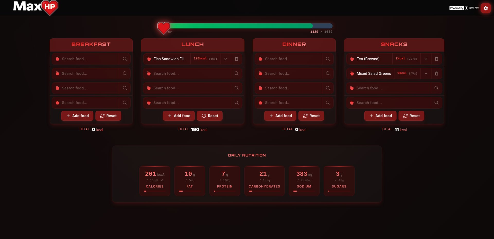
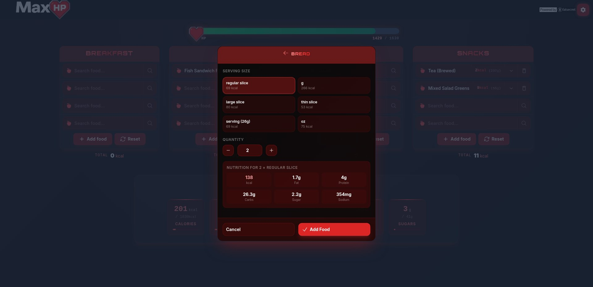
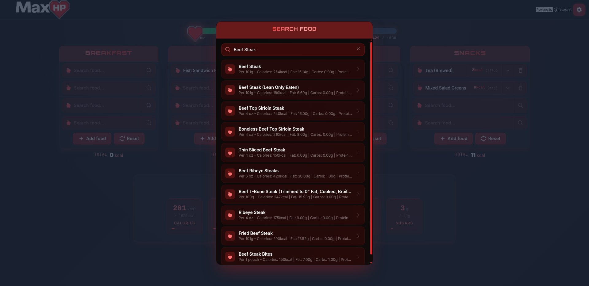

# MaxHP — Level Up Your Health


A gamified calorie tracker that turns your nutrition into an RPG health bar. Built with Nuxt 4 and powered by the FatSecret API.

## Features

- **Per-meal food logging** — Track Breakfast, Lunch, Dinner, and Snacks independently
- **FatSecret food search** — Search a vast nutrition database with detailed serving/portion adjustment
- **HP-bar calorie visualization** — See calories as a health bar with color transitions (green → yellow → orange → red)
- **BMR / TDEE calculator** — Set your Basal Metabolic Rate with activity level and deficit/surplus targeting
- **14-day analytics** — Bar/line charts for calories vs. target, weight trend, and macronutrient breakdown
- **Weight tracking** — Log weight daily, view trendline on the chart
- **Custom foods** — Create and save your own food entries
- **Community food database** — Share and discover foods via a community-driven D1-backed CRUD with moderation
- **Date navigation** — View or edit past days; auto-switches to today at midnight

## Tech Stack

| Tool                                                                           | Purpose                                                  |
| ------------------------------------------------------------------------------ | -------------------------------------------------------- |
| [Nuxt 4](https://nuxt.com/)                                                    | SSR / static framework (Nitro preset `cloudflare-pages`) |
| [Nuxt UI v4](https://ui.nuxt.com/)                                             | UI component library, primary color "gaming"             |
| [Tailwind CSS v4](https://tailwindcss.com/)                                    | Utility-first CSS with custom `@theme` tokens            |
| [Vue 3](https://vuejs.org/)                                                    | UI framework (`<script setup lang="ts">`)                |
| [TypeScript](https://www.typescriptlang.org/)                                  | Strict mode throughout                                   |
| [Chart.js](https://www.chartjs.org/) + [vue-chartjs](https://vue-chartjs.org/) | Analytics charts                                         |
| [FatSecret API](https://platform.fatsecret.com/)                               | Food search and nutrition data (OAuth1 + OAuth2)         |
| [Cloudflare D1](https://developers.cloudflare.com/d1/)                         | Community food database                                  |

## Preview





## Getting Started

### Prerequisites

- Node.js v18+
- pnpm

### Installation

1. Clone the repository:

   ```bash
   git clone https://github.com/Stormesh/simple-calorie-tracker.git
   cd simple-calorie-tracker
   ```

2. Install dependencies (postinstall runs `nuxt prepare`):

   ```bash
   pnpm install
   ```

3. Create a `.env` file in the project root with your FatSecret API credentials:

   ```env
   NUXT_API_KEY=your_api_key
   NUXT_API_SECRET=your_api_secret
   NUXT_API_CLIENT_SECRET=your_oauth2_client_secret
   ```

   > Register at [FatSecret Platform](https://platform.fatsecret.com/) to obtain credentials. OAuth2 is preferred; OAuth1 falls back automatically.

### Development

```bash
pnpm run dev
```

Open [http://localhost:3000](http://localhost:3000).

### Lint

```bash
pnpm exec eslint .
```

### Build

```bash
pnpm run build      # Server build → .output
pnpm run generate   # Static export → dist
pnpm run preview    # Preview production build
```

## Project Structure

```
app/
  app.vue                — Root: UApp > NuxtLayout > NuxtPage
  app.config.ts          — Nuxt UI theme (primary: gaming)
  pages/index.vue        — Single-page app
  layouts/default.vue    — Background gradient + header + slot
  components/            — 21 auto-imported components
  composables/           — Auto-imported state & logic
    day-logs.ts          — DayLog CRUD, date switching, migration
    bmr-state.ts         — BMR/TDEE form (cookie-backed)
    aggregated-nutrients.ts — Computed totals from meal cookies
    weight-change.ts     — Deficit/surplus computation
    food-state.ts        — Food template defaults, cookie reset
    food-details.ts      — Food detail modal state
    community-foods.ts   — Community food CRUD
    custom-foods.ts      — Custom food CRUD
  utils/
    food-types.ts        — IFoodTemplate interface
    meals.ts             — ["Breakfast", "Lunch", "Dinner", "Snacks"]
  assets/css/app.css     — Tailwind theme, glass/glow/hp-bar utilities
server/
  api/
    nutrition/search/[name].ts  — FatSecret food search
    nutrition/[id].ts           — FatSecret food detail
    community/
      search.get.ts             — Search community foods (D1)
      submit.post.ts            — Submit a community food
      flag.post.ts              — Flag a community food
      flagged.get.ts            — List flagged foods (moderator)
      approve.post.ts           — Approve a flagged submission
      delete.post.ts            — Delete a community food
  utils/
    db.ts                — D1 database access
    fatsecret-auth.ts    — OAuth1/OAuth2 helpers
    fatsecret-oauth1.ts
    fatsecret-oauth2.ts
    food-cache.ts        — Per-request in-memory cache
    rate-limit.ts        — API rate limiting
    blocklist.ts         — Content moderation blocklist
```

### State Storage

| Store          | Type              | Key                                             |
| -------------- | ----------------- | ----------------------------------------------- |
| Day logs       | `useLocalStorage` | `maxhp-day-log:all`                             |
| Meal foods     | `useLocalStorage` | `maxhp-meal:{Breakfast\|Lunch\|Dinner\|Snacks}` |
| Custom foods   | `useLocalStorage` | `custom-foods`                                  |
| Current date   | `useCookie`       | `current-date`                                  |
| BMR form       | `useCookie`       | `bmr`                                           |
| Theme / accent | `useCookie`       | `theme`, `accent`                               |
| Player name    | `useCookie`       | `player-name`                                   |
| Migration flag | `useLocalStorage` | `maxhp-migrated`, `maxhp-meals-migrated`        |

Everything lives on the device: there are no accounts and no server-side user data. Settings → **Data → Export backup** writes one JSON file with the whole state, and **Import backup** restores it — which is also how data moves from the browser to the Android app.

### Configuration

- **Calorie target** — Set in the Diet Profile modal (BMR + activity level + deficit/surplus)
- **Unit system** — Metric (kg/cm) or Imperial (lbs/in) in Diet Profile
- **Custom foods** — Add via the "Custom Food" button in any meal section
- **Search provider** — FatSecret; falls back from OAuth2 to OAuth1

## Android app (APK)

The same app ships as an Android app through [Capacitor](https://capacitorjs.com/) — no second codebase, no Play Store. The APK is a WebView around a static (`ssr: false`) export of this repo, and the API stays on Cloudflare Pages, so the web deployment is unchanged.

### Building

Prerequisites: JDK 21 (the Gradle in the Capacitor template rejects newer), the Android SDK (`sdk.dir` in `android/local.properties` or `ANDROID_HOME`), and a device or emulator.

```bash
pnpm run cap:sync    # NUXT_MOBILE=1 nuxt generate, then copy into android/
pnpm run cap:android # optional: open Android Studio for SDK/AVD management
cd android && ./gradlew assembleDebug
adb install -r app/build/outputs/apk/debug/app-debug.apk
```

`NUXT_MOBILE=1` is a build flag, not a config fork: it sets `ssr: false` and the static Nitro preset, and nothing else. `nuxt.config.ts` refuses to build that way in a `CF_PAGES` environment, so a mobile build can never replace the deployed web app.

The APK talks to `https://maxhp.pages.dev` by default. Point it elsewhere (a preview deployment, a local `pnpm dev`) with:

```bash
NUXT_PUBLIC_API_BASE=https://<branch>.maxhp.pages.dev pnpm run cap:sync
```

The base is baked in at build time, so it has to be set for every `cap:sync`, not once. The app calls the same `/api/*` routes the web does, cross-origin — that is why `server/utils/cors.ts` allows the WebView origins for the public API only, while the moderator routes stay unreachable from a browser.

### Signing

Release builds need a keystore. `android/keystore.properties` and the `.jks` it points at are both gitignored, so they never enter the repo or the Pages build.

```bash
cd android
keytool -genkeypair -v -keystore app/maxhp-release.jks \
  -alias maxhp -keyalg RSA -keysize 2048 -validity 10000

cat > keystore.properties <<EOF
storeFile=maxhp-release.jks
storePassword=<password>
keyAlias=maxhp
keyPassword=<password>
EOF
```

> **Back this up somewhere outside the repo.** The keystore is the app's identity: lose it and a new build is a different app to Android — it cannot be installed over the old one, and updating means uninstalling first, which deletes all local data.

Then bump `versionCode` (an integer that must always increase) and `versionName` in `android/app/build.gradle`, commit, and publish:

```bash
pnpm run apk:release v1.0.0
```

That regenerates the SPA, builds the signed APK and attaches `MaxHP-<version>.apk` to a GitHub release via `gh`. Nothing is pushed; the release is the only network write.

### What the shell changes

- **Absolute API base** — inside the WebView the app is served from `https://localhost`, so a relative `/api/…` would resolve in the shell and 404. Every request goes through `apiUrl()`.
- **External links leave the app** — a plain link would navigate the WebView itself, and there is no address bar to get back with. The FatSecret logo hands its URL to the system browser instead.
- **Safe areas** — Android 15+ enforces edge-to-edge, so the header and the overlays pad with `env(safe-area-inset-*)`; on the web those resolve to `0px`.
- **Hardware back** — closes the open dialog, otherwise goes back in the history, otherwise exits.
- **Keyboard** — the WebView resizes natively, so a focused input is never hidden under the keyboard.
- **Meals in localStorage** — a cookie caps at ~4 KB and truncates a real meal silently; day logs, meals and custom foods are localStorage, small settings stay cookies.
- **No iOS build.** iPhone users get the PWA: open the site in Safari and _Add to Home Screen_.

## Deployment

This app is designed for [Cloudflare Pages](https://pages.cloudflare.com/), with D1 for the community database (`maxhp-community`, configured in `wrangler.toml`).

Cloudflare Pages deploys on every push: `master` to production, other branches to a preview. GitHub Actions only verifies (lint, typecheck, tests, build) — it does not deploy, and a failing run does not stop the Pages deploy.

Secrets belong to the Pages project, not the build:

```bash
npx wrangler pages secret put NUXT_API_KEY --project-name maxhp
npx wrangler pages secret put NUXT_API_SECRET --project-name maxhp
npx wrangler pages secret put NUXT_MODERATOR_SECRET --project-name maxhp
```

Schema changes are applied deliberately, before the code that needs them is pushed:

```bash
npx wrangler d1 migrations apply maxhp-community --remote
```

`migrations/0003 → backfill → 0004` is the one sequence that needs a step in between; see `AGENTS.md` for the order.

### Environment Variables

| Variable                 | Required | Description                                                  |
| ------------------------ | -------- | ------------------------------------------------------------ |
| `NUXT_API_KEY`           | Yes      | FatSecret consumer key                                       |
| `NUXT_API_SECRET`        | Yes      | FatSecret consumer secret                                    |
| `NUXT_API_CLIENT_SECRET` | No       | FatSecret OAuth2 client secret; enables OAuth2 (else OAuth1) |
| `NUXT_MODERATOR_SECRET`  | No       | Community food moderation secret                             |

These names are not arbitrary: Nitro overrides `runtimeConfig` keys from
`NUXT_`-prefixed environment variables at runtime. `nuxt.config.ts` must leave
the keys empty, otherwise the values are inlined into the deployed bundle.

---

Powered by [FatSecret](https://platform.fatsecret.com/)
